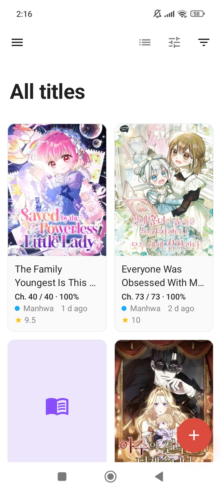
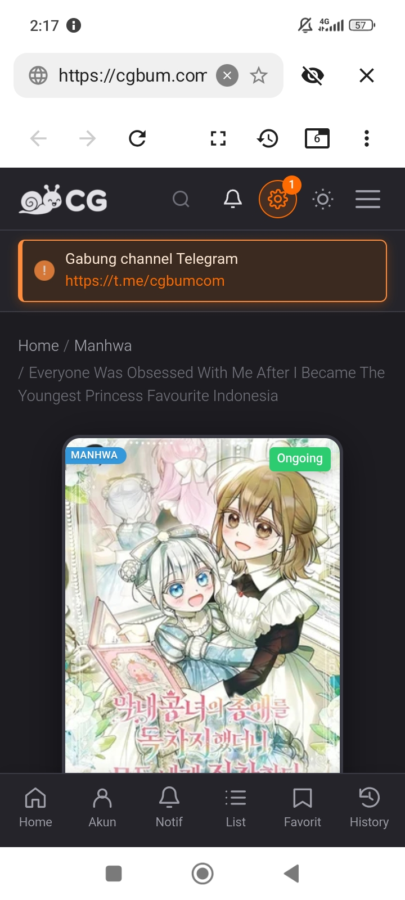
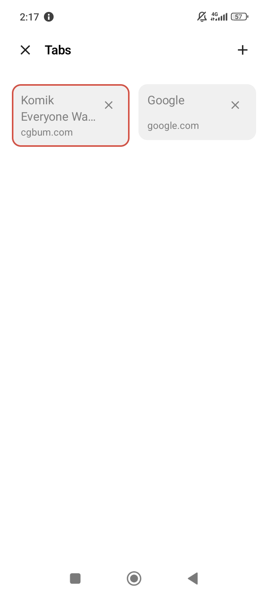
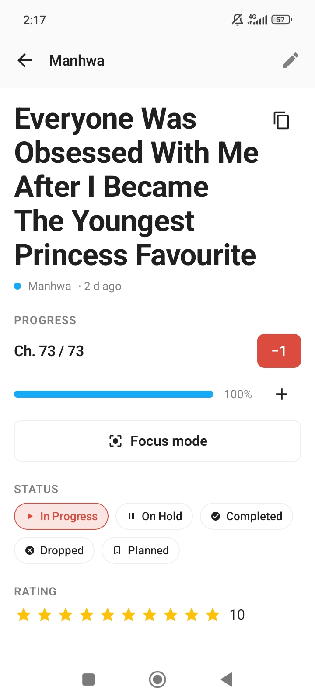
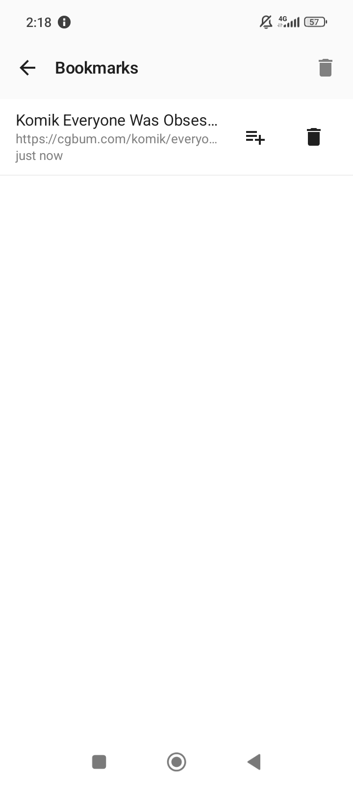

# Series Log — Public Releases

**Series Log** is an offline Android tracker for the series you follow — with a built-in browser for reading, per-series progress, and no account or cloud sync. Your data stays on your phone.

## Screenshots

   
  <b>Library</b> — Your series at a glance, with progress, ratings, and recency

   
  <b>Browser</b> — Read in the built-in browser, with tabs and a clean read mode

   
  <b>Tabs</b> — Chrome-style tab switcher, persistent across sessions

   
  <b>Series detail</b> — Progress, status, and a 10-star rating per series

   
  <b>Bookmarks</b> — Save pages to pick up where you left off

## Features

- **Built-in browser** — Chrome-style tabs, bookmarks, history, and a clean read mode
- **On-device image translation** — translate text in images with ML Kit, no server needed
- **Progress tracking** — per-series progress with smart suggestions from the page you're on
- **Genres & ratings** — ~70 default genres, star ratings, and completion badges
- **Per-site controls** — element blocking and domain lock, tuned per site
- **Quick lock** — lock the app behind a plain cover screen, fingerprint to get back
- **Private by design** — offline-first, no account, local backup

## Get the app

Download the latest signed APK from the **[Releases](https://github.com/Anjasfedo/series-log-releases/releases)** page and install it on your Android phone (Android 7.0 or newer, ±78 MB). Release builds install over previous versions, keeping your data.

## About this repo

This repository contains **only release artifacts** — the source code lives in a private repository. Each release is built here on GitHub Actions by checking out the private source with a read-only deploy key, compiling a signed release APK, and wiping the source from the runner before publishing. No source code is ever committed to this repo.

Builds are triggered manually per release tag (e.g. `v1.11.0-31cac7c`). Release notes come from the private repo's `CHANGELOG.md`.

Built with Kotlin, Jetpack Compose, Room, and Hilt.
